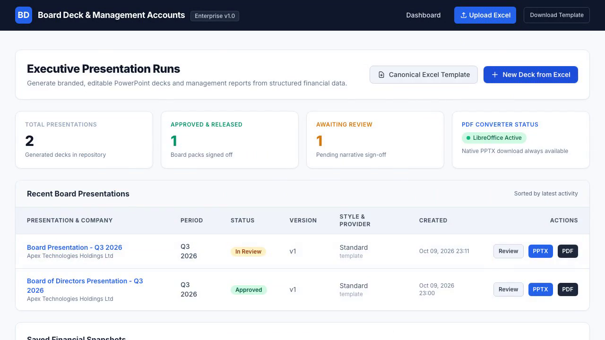
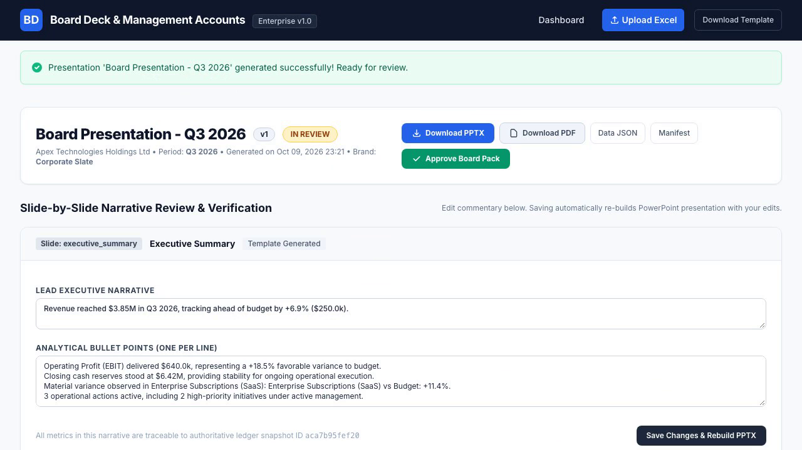
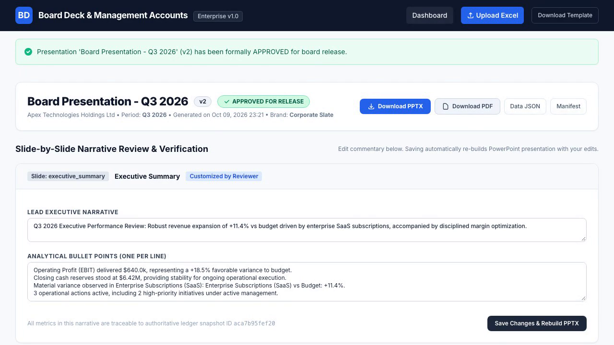

# Automated Board Deck & Management Accounts Generator

An enterprise-grade financial presentation generator that automatically transforms structured financial data and Excel workbooks into branded, editable PowerPoint (`.pptx`) board packs and management accounts presentations.

Unlike generic AI slide tools that generate static screenshots or unstructured bullets, this system produces **genuine, editable PowerPoint presentations** with native tables, shapes, charts, and deterministic commentary grounded directly in verified financial facts.

---

## Key Features

1. **Canonical Financial Reporting Schema & Strict Decimal Math:**
   - Full support for Income Statement, Balance Sheet, Cash Flow, KPIs, Risks, and Actions.
   - Exact `Decimal` calculations; explicit `None` handling (never silently zeroes missing figures).
   - Provenance tracking with unique Fact IDs for every material financial figure.

2. **Excel Ingestion & Validation Engine:**
   - Safe `.xlsx` workbook parsing without macro execution.
   - Automatic sheet and header detection (`P&L`, `Balance Sheet`, `Cash Flow`, `KPIs`, `Risks & Actions`).
   - Pre-generation validation checks with row-level error and warning flags.
   - Downloadable canonical Excel template (`sample_board_deck_data.xlsx`).

3. **Master Presentation Template & Slide Library (10 Slide Types):**
   - **Slide 1:** Cover Page (Branding, Legal Entity, Period, Publication Date).
   - **Slide 2:** Executive Summary (KPI summary cards, lead narrative, strategic focus).
   - **Slide 3:** Financial Performance Overview (Native Clustered Column & Trend Charts, Margin commentary).
   - **Slide 4:** Profit & Loss Statement (Native structured financial table with Actual, Budget, Prior, Var $, Var %, YTD).
   - **Slide 5:** Balance Sheet (Assets, Liabilities, Equity, Net Working Capital).
   - **Slide 6:** Statement of Cash Flows (Operating, Investing, Financing cash conversion & runway).
   - **Slide 7:** KPI Scorecard (2x3 metric grid with green/amber/red status & trend line chart).
   - **Slide 8:** Risks & Anomalies (Material variance thresholds & risk mitigation register).
   - **Slide 9:** Actions & Decisions (Governance matrix with priority, owner, target date, and status).
   - **Slide 10:** Appendix & Methodology (Accounting basis, variance thresholds, data provenance hash).

4. **Deterministic Commentary Provider:**
   - Fact-grounded commentary engine configured via `BOARD_COMMENTARY_PROVIDER=template`.
   - Supports 3 narrative styles: `concise` (tight board pack), `standard` (management narrative), and `detailed` (in-depth analyst commentary).
   - Strictly enforces character bounds to prevent slide overflow.
   - Abstract provider interface ready for future Claude / AI provider integration without rewriting presentation code.

5. **Review, Inline Narrative Editing & Approval Lifecycle:**
   - Status tracking: `Draft` &rarr; `In Review` &rarr; `Approved`.
   - Live slide-by-slide narrative editing in browser.
   - Automatic PowerPoint re-rendering upon saving narrative edits.
   - Invalidation of previous approval if a deck is modified post-signoff.

6. **Exports & PDF Conversion:**
   - Direct download of native editable `.pptx`.
   - Optional local PDF conversion via headless LibreOffice with graceful fallback if not installed.
   - Downloadable data summary snapshot (`JSON`) and generation audit manifest (`JSON`).

---

## Quick Start & Local Setup

### 1. Prerequisites
- Python 3.10+ (tested on Python 3.13)
- SQLite (included with Python)
- *(Optional)* LibreOffice installed locally for PDF generation

### 2. Environment Setup
```bash
# Clone or navigate to the repository
cd board_deck_generator

# Create and activate virtual environment
python3 -m venv venv
source venv/bin/activate  # On Windows: venv\Scripts\activate

# Install dependencies
pip install -r requirements.txt
```

### 3. Database Migrations
```bash
python manage.py makemigrations board_deck
python manage.py migrate
```

### 4. Seed Fictional Enterprise Demo Dataset
Populate the database with a fictional B2B SaaS enterprise (*Apex Technologies Holdings Ltd*), 6+ months of historical data, budget variances, KPIs, risk registers, and a pre-generated board presentation:
```bash
python manage.py seed_board_demo
```

### 5. Run the Local Development Server
```bash
python manage.py runserver
```
Visit **[http://127.0.0.1:8000](http://127.0.0.1:8000)** in your browser.

---

## Workflow Guide

### 1. Uploading an Excel Workbook
1. Click **"Upload Excel"** from the top navigation bar.
2. Select an `.xlsx` file (or download the canonical template from `/download/sample-workbook/`).
3. The system parses all sheets, inspects column headers, runs accounting validations, and displays a preview.
4. Click **"Proceed to Deck Generator"** once required validations pass.

### 2. Configuring & Generating a Presentation
1. Choose a presentation title (e.g. *Q3 2026 Board Review*).
2. Select a visual brand theme:
   - **Corporate Slate** (Navy `#0F172A`, Slate `#334155`, Royal Blue `#2563EB`)
   - **Executive Navy** (Deep Blue `#0A192F`, Sky `#0284C7`)
   - **Emerald Finance** (Forest `#064E3B`, Emerald `#059669`)
3. Select narrative density: `Concise`, `Standard`, or `Detailed`.
4. Toggle specific slides to include (Slide 1 through 10).
5. Click **"Generate PowerPoint Deck"**.

### 3. Reviewing & Editing Narrative Content
1. Navigate to the **Review** screen for your presentation.
2. Inspect the generated slide commentary and supporting financial facts.
3. Edit lead summaries or bullet points directly in the web UI.
4. Click **"Save Changes & Rebuild PPTX"** — the system regenerates the PowerPoint deck with your updated narrative, increments the version number (`v2`, `v3`...), and resets approval status if previously signed off.

### 4. Formal Sign-Off & Approval
1. Click **"Approve Board Pack"** on the review screen.
2. The deck is marked as `APPROVED FOR RELEASE` with reviewer stamp, version lock, and audit log.

### 5. Exporting Presentations
- **Download PPTX:** Always available. Produces a 16:9 widescreen presentation with native editable tables and charts.
- **Download PDF:** Available when LibreOffice is installed locally.
- **Data JSON & Manifest JSON:** Authoritative snapshots of data payload and generation audit logs.

---

## Service Architecture

```
board_deck_generator/
├── config/                      # Django project configuration
│   ├── settings.py
│   ├── urls.py
│   └── wsgi.py
├── board_deck/                  # Django app
│   ├── models.py                # Database models & audit trails
│   ├── views.py                 # Dashboard, upload, generate, review, download views
│   ├── forms.py                 # Upload and config forms
│   ├── urls.py                  # URL routing
│   └── management/commands/     # seed_board_demo command
├── services/                    # Modular business service layer
│   ├── finance/
│   │   ├── canonical_schema.py  # Typed dataclasses & Fact IDs
│   │   ├── normalization.py     # Data normalization & Decimal casting
│   │   └── metrics.py           # Financial metric calculation & variance engine
│   ├── imports/
│   │   ├── excel.py             # openpyxl workbook parser
│   │   └── validation.py        # Financial data & statement validator
│   ├── commentary/
│   │   ├── base.py              # Abstract CommentaryProvider interface
│   │   ├── templates.py         # Deterministic template-based narrative generator
│   │   └── factory.py           # Provider factory (BOARD_COMMENTARY_PROVIDER)
│   ├── presentations/
│   │   ├── tokens.py            # Brand configuration & design tokens
│   │   ├── layouts.py           # Slide headers, footers, card shapes, text frames
│   │   ├── charts.py            # Native python-pptx charts
│   │   ├── tables.py            # Native python-pptx tables
│   │   ├── validation.py        # Presentation validator & bounds checks
│   │   ├── builder.py           # Central PresentationBuilder orchestrator
│   │   └── slides/              # Slide 1 to 10 renderers
│   └── exports/
│       └── pdf.py               # Headless LibreOffice PDF conversion
├── sample_data/                 # Canonical sample Excel workbook
├── templates/                   # Django templates (Tailwind CSS styled)
│   ├── base.html
│   └── board_deck/
└── tests/                       # Automated test suite (pytest-django)
```

---

## Automated Test Suite

Run the full automated test suite:
```bash
pytest -v
```

### Test Coverage Summary:
- Canonical schema decimal calculations and variance percentages.
- Excel workbook parsing, multi-sheet inspection, and category mappings.
- Missing required fields, invalid headers, and non-numeric data detection.
- Commentary fact reference grounding and narrative length bounding.
- PowerPoint generation for all 10 slide types with native tables and charts.
- Sub-selection of slides and custom commentary overrides.
- PDF conversion availability and graceful fallback behavior.
- Django views, narrative review editing, version increments, and approval invalidation.
- File upload security (rejection of non-`.xlsx` and oversized files).
- Demo dataset seeding command.

---

## PDF Conversion Setup (Optional)

To enable automatic `.pdf` conversion:
- **macOS:** Install LibreOffice (`brew install --cask libreoffice` or download from [libreoffice.org](https://www.libreoffice.org/)).
- **Ubuntu/Debian:** `sudo apt-get install -y libreoffice`
- Optional custom path in `.env`: `LIBREOFFICE_PATH=/path/to/soffice`

If LibreOffice is not installed, the application continues to operate with full functionality for PPTX generation and displays an informative notification.


## 🖼️ Application Screenshots

| Executive Deck Configuration | AI Outline & Narrative Structure |
|:---:|:---:|
|  |  |
| *Audience targeting, theme selection, & tone customization* | *Automated slide flow generation & executive messaging* |

| Live Slide Visual Editor | PowerPoint / PDF Export & Delivery |
|:---:|:---:|
|  |  |
| *Real-time card formatting, metric callouts, & layout tweaks* | *Pixel-perfect PPTX and PDF rendering with corporate branding* |
